# 練習依賴圖

這張圖畫出三條學習路線各階段之間的硬依賴，以及每個階段需要的外部依賴（要購買的硬體、工具與器材、運算環境）。用途是想練習時，直接看出「以目前的進度和手上的東西，哪些節點可以開始」。

- 路線內容以 [docs/](docs/README.md) 為準，進度以 [STATUS.md](STATUS.md) 為準。這張圖只把兩者畫在一起，不是新的進度來源。
- 圖上的狀態依據 `STATUS.md`，以及 [AGENTS.md](AGENTS.md)「使用者背景」中「手上的硬體零件」與「手上的工具與環境」兩行。
- 最後同步：2026-11-09（Asia/Taipei）。

## 怎麼讀

**節點**

- 方框是學習節點。預設一個階段一個節點。同一個階段內各列的依賴不同時，拆成多個節點，例如「S5 模擬」與「S5 實機」。必修列與選修列也分開成不同節點。每個節點對應 `STATUS.md` 的哪幾列，見[節點與 STATUS.md 的對應](#節點與-statusmd-的對應)。
- 六角形是外部依賴節點。節點文字列出包含的東西，全部到手才算「已有」。
- 節點文字裡的「教材」只是簡稱，完整連結在 `docs/` 對應章節。

**依賴線**

- 箭頭 A → B 表示：沒有 A，B 的主要練習做不下去。這張圖只畫這種硬依賴。
- 只在最後驗收才需要的東西不畫箭頭，寫在節點文字裡。例如 S1 的「Ubuntu 24.04 可編譯」。
- 先做會比較順、但不先做也能邊做邊借學的軟依賴不畫，交給 `/practice` 的借學規則處理。
- **實線**：`docs/` 寫明的依賴。**虛線加「推測」**：`docs/` 沒有寫明，由代理推測。每一條線的依據見[依賴線的來源](#依賴線的來源)。
- 箭頭指向一個框起來的群組（H10、H11）時，表示群組內每個節點都依賴它。

**狀態顏色**

| 顏色 | 狀態 | 判斷方式 |
| --- | --- | --- |
| 綠色 | 實際做過 | 節點對應的 `STATUS.md` 列全部是「實際做過」 |
| 黃色 | 進行中 | 至少一列是「進行中」或「實際做過」，但還沒全部做完 |
| 藍色 | 可開始 | 對應的列全部「未開始」，上游學習節點全部「實際做過」，上游外部依賴全部「已有」 |
| 灰色 | 被擋住 | 對應的列全部「未開始」，而且還有上游沒有滿足 |
| 淺綠六角形 | 已有 | 外部依賴全部到手 |
| 淺紅虛框六角形 | 沒有 | 外部依賴還缺至少一項 |

「可開始」與「被擋住」是依賴推算出來的，**不是** `STATUS.md` 的正式狀態。`STATUS.md` 仍然只有「未開始／進行中／實際做過」三種。

## 依賴圖

```mermaid
flowchart LR
  subgraph EXT["外部依賴"]
    X_AMR{{"AMR-1 零件組<br/>ESP32、TB6612、編碼器馬達 ×2、IMU<br/>LD19、3S 電池、降壓模組、Pi 4／5、底盤"}}
    X_TOOL{{"基本工具<br/>三用電表、烙鐵與焊錫"}}
    X_SCOPE{{"示波器"}}
    X_PRINT{{"3D 印表機"}}
    X_UBU{{"Ubuntu 24.04 環境<br/>ROS 2 Jazzy、Gazebo Harmonic"}}
    X_SO101{{"SO-101 套件<br/>leader 7.4V、follower 12V 與電源"}}
    X_CF{{"Crazyflie 2.1+"}}
    X_CFDECK{{"Crazyradio、Flow deck v2"}}
    X_ESPFLY{{"ESP-FLY 套件"}}
    X_X500{{"X500 V2 套件<br/>4S 電池、平衡充電器、防火袋、Pi 伴隨電腦"}}
    X_MP2{{"Mini Pupper 2<br/>STL-06P 光達"}}
    X_IND{{"工業通訊模組<br/>SN65HVD230、CAN HAT、MAX485"}}
    X_CAM{{"相機"}}
  end

  subgraph SW["軟體路線"]
    S1["S1 程式基礎<br/>C++、Python、Linux、Git<br/>教材：孔令傑、learncpp、Missing Semester<br/>24.04 編譯檢查在最後一步"]
    S2["S2 工程習慣<br/>CMake、GTest、Docker、CI<br/>教材：Modern CMake、GTest quickstart"]
    S3["S3 ROS 2 基礎<br/>URDF、rclcpp adapter、QoS 診斷<br/>教材：ROS 2 Jazzy Tutorials"]
    S4["S4 模擬與 ros2_control<br/>Gazebo DiffDrive、DiffBot<br/>教材：Gazebo Harmonic、ros2_control demos"]
    S5S["S5 模擬<br/>Gazebo 建圖與導航、§12 情境<br/>教材：Nav2、slam_toolbox"]
    S5R["S5 實機<br/>同一套設定搬到 AMR-1"]
    S6["S6 自寫演算法<br/>Nav2 plugin、C++ PID／EKF、profile<br/>教材：Nav2 Plugin Tutorials"]
    S7["S7 開源貢獻<br/>一個被 merge 的 PR<br/>教材：Nav2 Getting Involved"]
    S8M["S8 選：MoveIt + SO-101<br/>先模擬，有手臂才做實機<br/>教材：MoveIt 2 Getting Started"]
    S8H["S8 選：AMR-1 自寫 hardware interface<br/>沒有現成教材"]
    S8C["S8 選：OpenCV 標記偵測<br/>教材：OpenCV Bootcamp"]
    S8I["S8 選：Isaac Sim 或 MuJoCo<br/>Isaac Sim 要 RTX GPU，MuJoCo 不用"]
    S8F["S8 選：改 linorobot2_hardware 韌體<br/>教材：Modern C、micro-ROS"]
    S9S["S9 選：多旋翼模擬<br/>Crazyswarm2 sim、gz_x500 offboard<br/>教材：Crazyswarm2、PX4 offboard"]
    S9R["S9 選：X500 V2 實機 offboard"]
    S10["S10 選：Mini Pupper 2<br/>先模擬，有實機才上機<br/>教材：mini_pupper_ros ros2-jazzy"]
  end

  subgraph HW["硬體路線"]
    H0["H0 選：模擬器暖身<br/>教材：Learn Arduino 互動教學"]
    H1["H1 基本電路與工具<br/>教材：Falstad、SparkFun、Adafruit"]
    H2["H2 電源與鋰電池安全<br/>教材：MIT EHS"]
    H3["H3 MCU：ESP32<br/>教材：toptechboy、Random Nerd、Wokwi"]
    H4["H4 馬達、驅動與感測器<br/>教材：SparkFun TB6612、Adafruit BNO085"]
    H5["H5 示波器除錯<br/>教材：SparkFun Oscilloscope"]
    H6["H6 選：CAD + 3D 列印<br/>教材：Onshape、Teaching Tech"]
    H7["H7 AMR-1 整機組裝<br/>教材：linorobot2_hardware"]
    H8["H8 選：SO-101 組裝<br/>教材：LeRobot SO-101"]
    H9C["H9 選：CAN<br/>教材：CSS Electronics、ESP-IDF TWAI"]
    H9B["H9 選：Modbus<br/>教材：PyModbus"]
    H9Q["H9 選：MQTT<br/>教材：HiveMQ、Mosquitto"]
    subgraph H10["H10 選：多旋翼"]
      H10E["ESP-FLY 焊接與懸停"]
      H10C["Crazyflie 手控飛行"]
      H10B["1S／4S 電池說明"]
      H10X["X500 V2 校正與定點懸停"]
    end
    subgraph H11["H11 選：四足"]
      H11D["架構與電源說明"]
      H11R["組裝、校正、逐一啟動"]
    end
  end

  subgraph TH["知識路線"]
    K1["K1 數學複習<br/>不另排教材"]
    K2["K2 運動學（必修列）<br/>差速運動學、里程計誤差<br/>教材：Modern Robotics Ch 2–6、13"]
    K2X["K2 選：SO-101、多旋翼、四足<br/>教材：Modern Robotics Ch 4–6"]
    K3["K3 控制（必修列）<br/>教材：林沛群自動控制、Brunton"]
    K3D["K3 選：多旋翼串級說明<br/>教材：PX4 Controller Diagrams"]
    K3T["K3 選：gz_x500 調角速度環 P"]
    K4["K4 機率機器人學（必修列）<br/>教材：rlabbe、Stachniss"]
    K4R["K4 選：讀 Crazyflie 與 PX4 估測<br/>教材：kalman_core.c、EKF2"]
    K4O["K4 選：out-of-tree 自寫估測器"]
    K5["K5 路徑規劃<br/>教材：LaValle Ch 2、5"]
    K6D["K6 選：IL／RL 與傳統方法取捨<br/>教材：李宏毅 DRL、HF Deep RL"]
    K6L["K6 選：LeRobot 模仿學習<br/>教材：LeRobot"]
  end

  %% 實線：docs/ 寫明的依賴
  X_TOOL --> H1
  X_AMR --> H1
  X_AMR --> H3
  X_SCOPE --> H5
  X_PRINT --> H6
  X_AMR --> H6
  X_SO101 --> H8
  X_IND --> H9C
  X_IND --> H9B
  X_AMR --> H9B
  H7 --> H9Q
  H1 --> H10
  H2 --> H10
  H1 --> H11
  H2 --> H11
  X_ESPFLY --> H10E
  X_CF --> H10C
  X_X500 --> H10X
  X_MP2 --> H11R
  S1 --> S2
  S1 --> S3
  X_UBU --> S3
  X_UBU --> S4
  S5S --> S5R
  H7 --> S5R
  S5S --> S9S
  S9S --> S9R
  S5S --> S10
  H7 --> S8H
  K3 --> K6D
  K4 --> K6D
  K5 --> K6D
  H8 --> K6L
  K4R --> K4O

  %% 虛線：代理推測的硬依賴
  S1 -. 推測 .-> S4
  S4 -. 推測 .-> S5S
  S5S -. 推測 .-> S6
  S2 -. 推測 .-> S6
  K4 -. 推測 .-> S6
  S1 -. 推測 .-> S7
  S4 -. 推測 .-> S8M
  S4 -. 推測 .-> S8H
  H7 -. 推測 .-> S8C
  X_CAM -. 推測 .-> S8C
  H7 -. 推測 .-> S8F
  H10X -. 推測 .-> S9R
  H1 -. 推測 .-> H4
  H2 -. 推測 .-> H4
  H3 -. 推測 .-> H4
  H4 -. 推測 .-> H5
  H4 -. 推測 .-> H7
  H4 -. 推測 .-> H9C
  K2 -. 推測 .-> K4
  K4 -. 推測 .-> K4R
  S9S -. 推測 .-> K3T
  S1 -. 推測 .-> K4O
  H10C -. 推測 .-> K4O
  X_CFDECK -. 推測 .-> K4O

  classDef done fill:#2e7d32,stroke:#1b5e20,color:#ffffff
  classDef doing fill:#f9a825,stroke:#f57f17,color:#000000
  classDef ready fill:#1565c0,stroke:#0d47a1,color:#ffffff
  classDef blocked fill:#e0e0e0,stroke:#9e9e9e,color:#424242
  classDef have fill:#c8e6c9,stroke:#2e7d32,color:#1b5e20
  classDef missing fill:#ffcdd2,stroke:#c62828,color:#b71c1c,stroke-dasharray:4 3

  %% 狀態：更新時只在下面幾行之間搬移節點代號
  class S1,S8I,H0,H2,K1,K2,K2X,K3,K3D,K5 ready
  class S2,S3,S4,S5S,S5R,S6,S7,S8M,S8H,S8C,S8F,S9S,S9R,S10 blocked
  class H1,H3,H4,H5,H6,H7,H8,H9C,H9B,H9Q,H10E,H10C,H10B,H10X,H11D,H11R blocked
  class K3T,K4,K4R,K4O,K6D,K6L blocked
  class X_AMR,X_TOOL,X_SCOPE,X_PRINT,X_UBU,X_SO101,X_CF,X_CFDECK,X_ESPFLY,X_X500,X_MP2,X_IND,X_CAM missing
```

## 現在可開始

排序規則是固定的，不含代理的推薦：

1. 必修節點排在選修節點前面。
2. 同一組內，下游節點越多的排越前面。下游節點是指直接或間接依賴它的學習節點。
3. 下游節點數相同時，依節點代號的字母與數字順序排。

**必修**

| 節點 | 下游節點數 |
| --- | --- |
| H2 電源與鋰電池安全 | 17 |
| S1 程式基礎 | 14 |
| K2 運動學（必修列） | 5 |
| K3 控制（必修列） | 1 |
| K5 路徑規劃 | 1 |
| K1 數學複習 | 0 |

**選修**

| 節點 | 下游節點數 |
| --- | --- |
| H0 模擬器暖身 | 0 |
| K2 選：SO-101、多旋翼、四足 | 0 |
| K3 選：多旋翼串級說明 | 0 |
| S8 選：Isaac Sim 或 MuJoCo | 0 |

## 節點與 STATUS.md 的對應

「第 n 列」指 `STATUS.md` 該階段表格中由上往下數的第 n 列。

| 節點 | 對應的 STATUS.md 列 |
| --- | --- |
| S1、S2、S3、S4、S6、S7 | 該階段全部的列 |
| S5S（S5 模擬） | S5 第 1、3 列 |
| S5R（S5 實機） | S5 第 2 列 |
| S8M | S8 選「SO-101 模擬 MoveIt pick-and-place……」 |
| S8H | S8 選「AMR-1 自寫 ros2_control hardware interface」 |
| S8C | S8 選「AMR-1 加相機，偵測 ArUco 或顏色標記」 |
| S8I | S8 選「把 AMR-1 或 SO-101 匯入 Isaac Sim 或 MuJoCo」 |
| S8F | S8 選「讀懂並修改 linorobot2_hardware 韌體」 |
| S9S（S9 模擬） | S9 第 1、2 列 |
| S9R（S9 實機） | S9 第 3 列 |
| S10 | S10 全部的列 |
| H0–H8 | 該階段全部的列 |
| H9C、H9B、H9Q | H9 第 1、2、3 列 |
| H10E、H10C、H10B、H10X | H10 第 1、2、3、4 列 |
| H11R | H11 第 1、3 列 |
| H11D | H11 第 2 列 |
| K1、K5 | 該階段全部的列 |
| K2（必修列） | K2 第 1、2 列 |
| K2X | K2 第 3–7 列 |
| K3（必修列） | K3 第 1–3 列 |
| K3D | K3 第 4、5 列 |
| K3T | K3 第 6 列 |
| K4（必修列） | K4 第 1–3 列 |
| K4R | K4 第 4、6、7 列 |
| K4O | K4 第 5 列 |
| K6D | K6 第 1 列 |
| K6L | K6 第 2 列 |

外部依賴節點的狀態來源：

- 「手上的硬體零件」：AMR-1 零件組、SO-101 套件、Crazyflie 2.1+、Crazyradio 與 Flow deck v2、ESP-FLY 套件、X500 V2 套件、Mini Pupper 2、工業通訊模組、相機。
- 「手上的工具與環境」：基本工具、示波器、3D 印表機、Ubuntu 24.04 環境。

## 依賴線的來源

### 實線：docs/ 寫明

| 依賴 | 依據 |
| --- | --- |
| 基本工具 → H1 | hardware H1「用三用電表量出……」「幫 IMU／馬達驅動模組焊上排針」 |
| AMR-1 零件組 → H1 | hardware H1「量出 AMR-1 電池電壓、降壓模組輸出」 |
| AMR-1 零件組 → H3 | hardware H3「用中斷讀出 AMR-1 單顆馬達的編碼器計數」 |
| 示波器 → H5 | hardware H5「用示波器量出 AMR-1 馬達 PWM 的頻率與 duty cycle」 |
| 3D 印表機、AMR-1 零件組 → H6 | hardware H6「畫出並印出 AMR-1 的 LiDAR 支架或電池座，尺寸一次對上」 |
| SO-101 套件 → H8 | hardware H8「完成組裝與校正，用 leader arm 遙控 follower arm」 |
| 工業通訊模組 → H9C | hardware H9「ESP32（TWAI + SN65HVD230 收發器）和 Pi（RS485／CAN HAT）」 |
| 工業通訊模組、AMR-1 零件組 → H9B | hardware H9「Pi 透過 MAX485 模組用 PyModbus 讀寫……」。Pi 屬於 AMR-1 零件組 |
| H7 → H9Q | hardware H9「AMR-1 把電量與狀態用 MQTT 發布」；hardware「整機在 H7」 |
| H1、H2 → H10 | hardware H10「做完 H1、H2 再做，不用等 H7」 |
| H1、H2 → H11 | hardware H11「做完 H1、H2 再做，不用等 H7」 |
| ESP-FLY 套件 → H10E | hardware H10「ESP-FLY 焊好並燒錄，用手機 App 控制懸停」 |
| Crazyflie 2.1+ → H10C | hardware H10「Crazyflie 2.1+ 組好，手控飛一次」 |
| X500 V2 套件 → H10X | hardware H10「X500 V2 在 QGroundControl 完成校正」；4S 用平衡充電器 |
| Mini Pupper 2 → H11R | hardware H11「用腿已先組好的版本組完」「裝上 STL-06P 後……」 |
| S1 → S2 | software S2「S1 的函式庫有 GTest」 |
| S1 → S3 | software S3「用 rclcpp 寫 teleop node，把 S1 函式庫包成 ROS adapter」 |
| Ubuntu 24.04 環境 → S3、S4 | software「Ubuntu 24.04 + ROS 2 Jazzy」；S3 用 Jazzy Tutorials，S4 用 Gazebo Harmonic 與 Jazzy 的 ros2_control demos |
| S5S → S5R | software S5「同一套設定搬到實機 AMR-1 上跑通」 |
| H7 → S5R | software S5「實機 AMR-1」；hardware「整機在 H7」 |
| S5S → S9S | software S9「建議 S5 做完就做」 |
| S9S → S9R | software S9「沿用模擬那支 node」 |
| S5S → S10 | software S10「建議 S5 做完就做……把 S5 的 SLAM Toolbox 與 Nav2 搬到四足上」 |
| H7 → S8H | software S8「`write()` 把 `diff_drive_controller` 的輪速命令送給 MCU」「AMR-1 改用 `diff_drive_controller` 控制，用鍵盤開得動」 |
| K3、K4、K5 → K6D | theory K6「說明 RL／IL 和 K3–K5 傳統方法的取捨」 |
| H8 → K6L | theory K6「用 LeRobot 在 SO-101 上錄示範資料」；SO-101 的組裝在 H8 |
| K4R → K4O | theory K4 多旋翼補充「先讀再寫」 |

### 虛線：代理推測

這些依賴沒有寫進 `docs/`。要不要寫進 `docs/`，由使用者決定。

| 依賴 | 推測理由 |
| --- | --- |
| S1 → S4 | DiffBot 的 hardware interface 是 C++，讀懂 `read()`／`write()` 要先會 C++ |
| S4 → S5S | S5 在 Gazebo 建圖用的 AMR-1 模擬，就是 S4 第 1 列跑起來的那套 |
| S5S → S6 | plugin 要取代 AMR-1 的 Nav2 預設元件，先要有跑得通的 Nav2 |
| S2 → S6 | plugin 要「附 GTest」，GTest 在 S2 學 |
| K4 → S6 | 用 C++ 重寫 EKF，要先懂 EKF |
| S1 → S7 | 送 PR 要會 Git，Git 在 S1 學 |
| S4 → S8M | S8 要說出 SO-101 的 `read()`／`write()` 和 DiffBot 的差異，DiffBot 在 S4 |
| S4 → S8H | 自寫 `SystemInterface` 以 DiffBot example_2 為參考 |
| H7、相機 → S8C | 「AMR-1 加相機」需要整機和一顆相機；也可能先在 Gazebo 加相機，如果你接受模擬版本，這兩條可以刪掉 |
| H7 → S8F | 改過的韌體要燒進 AMR-1 才能驗證 |
| H10X → S9R | offboard node 要在已組好、已校正的 X500 V2 上跑 |
| H1 → H4 | H4 用的 IMU 與驅動模組，要先焊好排針（H1 第 2 列） |
| H2 → H4 | 馬達接上 3S 電池前，要先懂電池安全 |
| H3 → H4 | H4 用到 PWM、中斷、I2C，這些在 H3 學 |
| H4 → H5 | 要先有轉動中的馬達，才量得到 PWM 與編碼器波形 |
| H4 → H7 | 整機接線用的是 H4 的驅動、編碼器、IMU 接法 |
| H4 → H9C | 要在 CAN bus 上傳輪速，先要能讀出編碼器轉速 |
| K2 → K4 | K4 第 1 列要說明輪式里程計的雜訊與失效，這是 K2 第 2 列的內容 |
| K4 → K4R | 讀 `kalman_core.c` 要先懂 EKF |
| S9S → K3T | 要先跑得起 `gz_x500`，才能改角速度環的 P |
| S1 → K4O | out-of-tree build 要寫 C 程式 |
| H10C → K4O | 比較「同一段飛行」，需要飛得起來的 Crazyflie |
| Crazyradio、Flow deck v2 → K4O | EKF 要有定位擴充板的量測；從電腦控制自主飛行要 Crazyradio |

### 沒有畫的軟依賴

以下關係先做會比較順，但不是硬依賴，交給 `/practice` 的借學規則：

- K2 → S1：差速運動學公式。`practice/S1/PLAN.md` 已經排成借學。
- K1 → S3、K1 → K2：齊次轉換。Modern Robotics Ch 3 本身會教。
- K3 → H4：輪速 PID。使用者已有 PID 理論。
- S2 → S3、S3 → S4：使用者已有 ROS 2 基礎；S4 的 Linorobot2 自帶 URDF。

## 更新方式

`AGENTS.md` 規定：修改 `STATUS.md` 的狀態，或修改「手上的硬體零件」「手上的工具與環境」兩行時，要在同一個提交更新這份檔案。步驟如下：

1. 依[節點與 STATUS.md 的對應](#節點與-statusmd-的對應)，找出受影響的節點。
2. 依[狀態顏色](#怎麼讀)的判斷方式，重新判斷受影響節點及其下游節點的狀態。
3. 在圖最後的 `class` 行之間搬移節點代號。需要「已有」「實際做過」「進行中」時，新增 `class … have`、`class … done`、`class … doing` 行。
4. 重新產生「現在可開始」兩張表。
5. 更新開頭的「最後同步」日期。

依賴線本身只在 `docs/` 的路線內容改變，或使用者決定修改推測依賴時才改。
